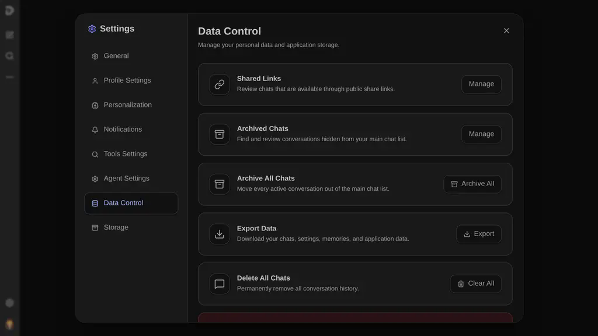
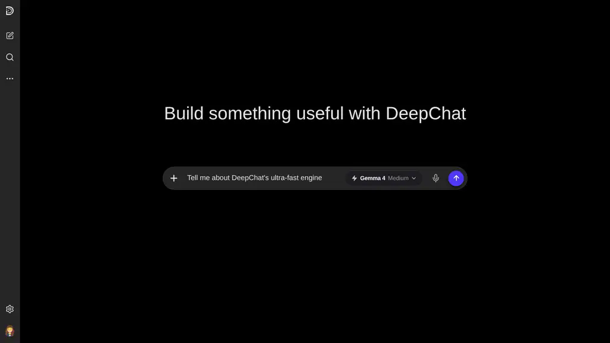

<div align="center">
  

  # DeepChat

  <p align="center">
    <strong>A next-generation, local-first AI chat workspace and agent environment.</strong>
  </p>

  <p align="center">
    <a href="https://img.shields.io/badge/status-active_development-blue?style=for-the-badge"></a>
    <a href="https://nextjs.org/"></a>
    <a href="https://react.dev/"></a>
    <a href="https://www.typescriptlang.org/"></a>
    <a href="https://tailwindcss.com/"></a>
    <a href="https://pnpm.io/"></a>
    <a href="./LICENSE"></a>
  </p>

  <p align="center">
    <a href="./README_id.md"><strong>Bahasa Indonesia (README_id.md)</strong></a>
  </p>
</div>

---

DeepChat is a feature-rich, local-first conversational workspace built with Next.js, React, and TypeScript. Inspired by the dynamic UX of ChatGPT and the agent-focused adaptability of OpenClaw, DeepChat provides a polished interface for advanced model experimentation, long-term memory extraction, interactive sandboxed code execution, and custom assistant behavior.

> [!WARNING]
> This application is currently under **active development**. Some features may change, break, or improve as the repository undergoes refinement toward stability.

---

## Key Capabilities

### Premium Mobile-First UI/UX
- Fully responsive interface designed layout-first for mobile devices, then seamlessly scaled for desktops.
- Sleek, modern design with glassmorphism touches, fluid animations powered by Framer Motion, and absolute focus on usability.
- Custom-tailored dark and light themes, collapsible sidebars, and customizable control panels.

### Semantic Long-Term Memory & Context
- Automated background memory extraction to build assistant understanding of the user.
- Persistent structured memories categorized by importance, time, and content type.
- Vectorizable history tracking to support semantic recall across multiple chat sessions.

### Deep Model Context Protocol (MCP) Integration
- Direct integration with Model Context Protocol servers to equip models with local and network tools.
- Granular MCP permissions, runtime tool configuration, and security gates.
- Built-in provider switcher with native support for the official Google GenAI SDK (Gemini models).

### Parallel Web Search (No API Key)
- Every search fans out in parallel across free, keyless engines — Parallel (hosted MCP), Brave, DuckDuckGo, and Wikipedia.
- If any engine is slow or fails, the others still return results; providers are merged with round-robin deduplication so citations stay diverse.
- Optional API-key providers (Brave API, Tavily, Perplexity, Exa, SerpAPI, Google CSE, Kagi, Linkup, OpenAI-compatible) join the same parallel fan-out when configured in Settings.

### Rich Developer Workflows & Sandboxes
- Full markdown layout with extensive LaTeX mathematical formula support (KaTeX) and GFM rendering.
- Syntax highlighting powered by Shiki for production-grade code readability.
- Embedded sandboxed execution environments to build, preview, and test generated code inside execution sessions.

### Local-First & Privacy Conscious
- Complete local persistence powered by SQLite via better-sqlite3 and type-safe schema mapping via Drizzle ORM.
- Private document directories where chats, logs, generated files, and profile details remain strictly on your local machine.

### Like / Dislike Feedback With Reasons
- Every finished assistant message carries working Like and Dislike actions. Likes are a quick toggle; Dislike opens a "Share feedback" sheet with selectable reason chips, an optional details field, and a Submit button.
- Reason chips are context-aware: a normal answer gets chips such as "Incorrect or incomplete", "Not what I asked for", and "Safety or legal concern", while an errored response gets an error-specific list led by "Always Error Response".
- Votes persist on the local machine in `data/deepchat-feedback.sqlite` (with a browser-side mirror for the session), so feedback can be inspected per chat/message later.

---

## Screenshots

### Home Screen


### Chat Screen


---

## Getting Started (Windows, macOS, Linux, and LAN)

DeepChat includes a cross-platform local launcher for production-style use on your own machine and inside your local network. Install once from the `scripts/` folder, then use the generated launcher in the project root.

### Windows

Run the installer from PowerShell:
```powershell
powershell.exe -NoProfile -ExecutionPolicy Bypass -File .\scripts\install.ps1
```
After installation, launch DeepChat by double-clicking **DeepChat.bat** in the project root.

### macOS, Linux, and Android Termux

Run the installer from a Bash shell:
```bash
bash scripts/install.sh
```
After installation, launch DeepChat from the project root:
```bash
./deepchat
```

After the first install, the generated launcher opens the existing production build directly. It does not download dependencies again, and it only asks about rebuilding if local source files changed after the last production build.

### Phone, Tablet, and LAN Access

Start DeepChat on Windows, macOS, Linux, or Termux, then open the displayed **LAN** URL from any phone, tablet, or computer on the same local network. iPhone and iPad are supported as browser clients.

#### What does the launcher do behind the scenes?
1. **Automated Directory Bootstrapping:** Safely creates the local file structure inside `data/` for chats, memories, temp artifacts, and logs.
2. **Dependency Manager:** Checks Node.js 20.9+, enables Corepack when available, and installs packages with `pnpm@10` including native `better-sqlite3` support.
3. **Interactive Production Build:** Builds only when no production build exists. If source files changed later, it asks whether to rebuild or start the existing production build.
4. **Port Allocation & PID Resolution:** Validates port availability. If port 3000 is already in use, it can open the running app, restart the server, switch to another port, or quit.
5. **Network / LAN Auto-Discovery:** Starts Next.js on `0.0.0.0`, resolves your LAN address, and displays a URL that works from other devices on the same network.
6. **Log Redirection & Log Filtering:** Writes runtime logs to `data/logs/deepchat.log` while keeping the launcher console focused on important server and AI output.

---

## Manual & Advanced Commands

For developers who prefer terminal controls, DeepChat supports standardized scripts via pnpm:

### Package Installation
Provide this instruction to install dependencies manually:
```bash
pnpm install
```

### Local Development Server
Launches the development instance with Turbopack for near-instant hot reloading:
```bash
pnpm dev
```

### Production Operations
Generate the production bundle:
```bash
pnpm build
```
Launch the compiled production bundle:
```bash
pnpm start
```
Perform code linting to ensure compliance with production quality:
```bash
pnpm lint
```

---

## Workspace Architecture

```text
deepchat/
├── data/                       # Local runtime environment (gitignored)
│   ├── chat/                   # User sessions and conversational snapshots
│   ├── llm/                    # Connection configurations and prompt profiles
│   ├── temp/                   # Session files and temporary downloads
│   ├── user/                   # Memory tables and user metadata
│   ├── backups/                # Periodic database and configuration backups
│   └── logs/                   # System runtime logs and event histories
├── docs/                       # Technical documentations and workspace guides
│   └── screenshots/            # Visual layout references
├── public/                     # Static assets
│   ├── icon.svg                # Main application logo
│   └── icons/                  # Modular icon packages
├── scripts/                    # Cross-platform install and launch automation
│   ├── install.ps1             # Windows installer
│   ├── install.sh              # macOS, Linux, and Termux installer
│   ├── launch.ps1              # Windows runtime launcher
│   ├── launch.sh               # macOS, Linux, and Termux runtime launcher
│   └── lib/                    # Shared launcher functions
├── src/                        # Primary React/Next.js codebase
│   ├── app/                    # Routing pages, layouts, actions, and styles
│   ├── components/             # Reusable UX modules and widgets
│   └── lib/                    # MCP settings, database layers, and generation scripts
├── package.json                # Project manifest and package configurations
└── tsconfig.json               # TypeScript rules and compilation schema
```

---

## Status & Future Directions

This application is actively developing under the workspace structure of a localized AI. Future releases target:
- Deepening multi-model orchestration.
- Advanced vector database capabilities for semantic long-term memory retrieval.
- Comprehensive tool pipelines and external execution security gates.
- Polished integrations for the Model Context Protocol ecosystem.

---

## License

DeepChat is open-source software licensed under the MIT License. All local storage, generation workflows, and customization modules are free to adapt, extend, and deploy.
