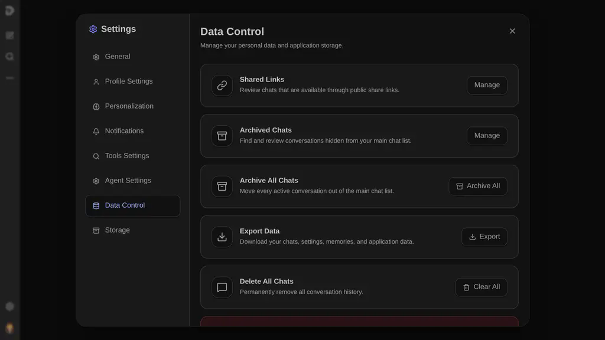
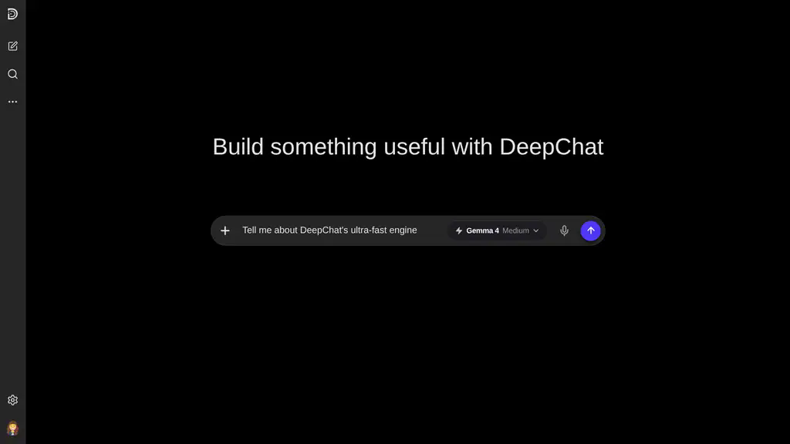

<div align="center">
  

  # DeepChat

  <p align="center">
    <strong>Ruang kerja percakapan dan lingkungan agen AI lokal generasi berikutnya.</strong>
  </p>

  <p align="center">
    <a href="https://img.shields.io/badge/status-active_development-blue?style=for-the-badge"></a>
    <a href="https://nextjs.org/"></a>
    <a href="https://react.dev/"></a>
    <a href="https://www.typescriptlang.org/"></a>
    <a href="https://tailwindcss.com/"></a>
    <a href="https://pnpm.io/"></a>
    <a href="./LICENSE"></a>
  </p>

  <p align="center">
    <a href="./README.md"><strong>English Version (README.md)</strong></a>
  </p>
</div>

---

DeepChat adalah ruang kerja percakapan berbasis lokal yang kaya fitur dan dibangun menggunakan Next.js, React, dan TypeScript. Terinspirasi oleh antarmuka dinamis milik ChatGPT serta fleksibilitas berbasis agen dari OpenClaw, DeepChat menghadirkan tampilan modern untuk eksperimen model tingkat lanjut, ekstraksi memori jangka panjang, eksekusi kode interaktif di lingkungan terisolasi (sandbox), dan penyesuaian perilaku asisten AI.

> [!WARNING]
> Aplikasi ini saat ini sedang dalam status **pengembangan aktif**. Fitur-fitur tertentu dapat berubah, diperbarui, atau disempurnakan seiring berjalannya penyetabilan repositori ke standar produksi.

---

## Fitur Utama

### Desain UI/UX Mengutamakan Perangkat Seluler (Mobile-First)
- Antarmuka responsif yang dirancang dengan memprioritaskan perangkat seluler (mobile screen), lalu disesuaikan dengan mulus untuk komputer desktop.
- Desain modern dan premium yang dilengkapi dengan efek glassmorphism, animasi halus berbasis Framer Motion, serta fokus tinggi pada pengalaman pengguna.
- Tema gelap dan terang yang disesuaikan secara khusus, bilah samping (sidebar) yang dapat disembunyikan, dan panel kontrol yang dinamis.

### Memori Jangka Panjang & Konteks Semantik
- Ekstraksi memori otomatis di latar belakang untuk membangun pemahaman yang dipersonalisasi dari profil pengguna.
- Memori terstruktur yang disimpan secara persisten dan dikelompokkan berdasarkan tingkat kepentingan, waktu, dan jenis konten.
- Pelacakan riwayat yang mendukung penelusuran semantik di berbagai sesi obrolan yang berbeda.

### Integrasi Mendalam Model Context Protocol (MCP)
- Terhubung langsung dengan server Model Context Protocol untuk memperluas kemampuan model menggunakan perkakas lokal maupun jaringan.
- Pengaturan izin MCP yang mendalam, konfigurasi peralatan runtime, dan pembatasan keamanan.
- Pengalih penyedia bawaan yang didukung secara native oleh Google GenAI SDK (model Gemini).

### Pencarian Web Paralel (Tanpa API Key)
- Setiap pencarian difan-out secara paralel ke mesin gratis tanpa kunci — Parallel (MCP ter-hosting), Brave, DuckDuckGo, dan Wikipedia.
- Jika salah satu mesin lambat atau gagal, mesin lainnya tetap mengembalikan hasil; provider digabungkan dengan deduplikasi round-robin agar sitasi tetap beragam.
- Provider dengan API key (Brave API, Tavily, Perplexity, Exa, SerpAPI, Google CSE, Kagi, Linkup, OpenAI-compatible) bergabung ke fan-out paralel yang sama saat dikonfigurasi di Pengaturan.

### Alur Kerja Developer & Sandbox Kode
- Tampilan Markdown lengkap dengan dukungan rumus matematika LaTeX (KaTeX) serta render GFM.
- Pewarnaan sintaksis menggunakan Shiki untuk meningkatkan kenyamanan membaca kode layaknya editor profesional.
- Modul eksekusi kode terisolasi (sandbox) untuk membangun, melihat pratinjau, dan menguji kode yang dihasilkan di dalam sesi langsung.

### Berbasis Lokal & Menjaga Privasi (Local-First)
- Penyimpanan data lokal penuh menggunakan SQLite via better-sqlite3 dan pemetaan skema berbasis Drizzle ORM yang aman.
- Direktori data pribadi di mana obrolan, log, berkas temporer, dan profil pengguna tetap berada sepenuhnya di komputer Anda.

### Like / Dislike Dengan Alasan (Share Feedback)
- Setiap pesan asisten yang selesai memiliki tombol Like dan Dislike yang berfungsi; masing-masing menampilkan ikon terisi (fill) setelah suara tersimpan.
- Keduanya membuka lembar "Share feedback" yang sama; tombol yang Anda ketuk menentukan arahnya. Chip alasan otomatis sesuai jenis pesan: jawaban biasa mendapat chip seperti "Incorrect or incomplete", "Not what I asked for", dan "Safety or legal concern", sedangkan respons yang error mendapat daftar khusus yang dipimpin oleh "Always Error Response".
- Suara (vote) disimpan per versi respons secara lokal di `data/deepchat-feedback.sqlite` (dengan cadangan di penyimpanan browser untuk sesinya), sehingga saat regenerasi pesan, respons versi baru memiliki rating baru yang terpisah tanpa menghilangkan feedback versi sebelumnya.

---

## Tampilan Antarmuka

### Halaman Beranda


### Halaman Percakapan


---

## Memulai (Windows, macOS, Linux, dan LAN)

DeepChat dilengkapi launcher lokal lintas platform untuk penggunaan production-style di mesin Anda sendiri dan jaringan lokal. Jalankan installer satu kali dari folder `scripts/`, lalu gunakan launcher yang otomatis dibuat di folder utama proyek.

### Windows

Jalankan installer dari PowerShell:
```powershell
powershell.exe -NoProfile -ExecutionPolicy Bypass -File .\scripts\install.ps1
```
Setelah instalasi selesai, jalankan DeepChat dengan mengklik dua kali **DeepChat.bat** di folder utama proyek.

### macOS, Linux, dan Android Termux

Jalankan installer dari Bash:
```bash
bash scripts/install.sh
```
Setelah instalasi selesai, jalankan DeepChat dari folder utama proyek:
```bash
./deepchat
```

Setelah instalasi pertama, launcher yang dibuat otomatis akan membuka build production yang sudah ada secara langsung. Dependency tidak diunduh ulang, dan launcher hanya menanyakan rebuild jika file source lokal berubah setelah build production terakhir.

### Ponsel, Tablet, dan Akses LAN

Jalankan DeepChat di Windows, macOS, Linux, atau Termux, lalu buka URL **LAN** yang tampil dari ponsel, tablet, atau komputer lain di jaringan lokal yang sama. iPhone dan iPad didukung sebagai client browser.

#### Apa yang dilakukan oleh peluncur otomatis ini di latar belakang?
1. **Penyusunan Folder Otomatis:** Secara aman membangun struktur folder di dalam direktori `data/` untuk menyimpan percakapan, memori, berkas temporer, dan log.
2. **Manajemen Dependensi Pintar:** Memeriksa Node.js 20.9+, mengaktifkan Corepack jika tersedia, dan memasang paket dengan `pnpm@10` termasuk dukungan native `better-sqlite3`.
3. **Build Production Interaktif:** Build hanya dilakukan saat belum ada build production. Jika file source berubah setelahnya, launcher akan bertanya apakah ingin rebuild atau tetap menjalankan build production yang sudah ada.
4. **Alokasi Port & Deteksi PID:** Memvalidasi ketersediaan port. Jika port 3000 sedang digunakan, launcher dapat membuka aplikasi yang sudah berjalan, restart server, memilih port lain, atau keluar.
5. **Deteksi Jaringan Lokal (LAN) Otomatis:** Menjalankan Next.js pada `0.0.0.0`, mendeteksi alamat LAN, dan menampilkan URL yang bisa dibuka dari perangkat lain di jaringan yang sama.
6. **Penyaringan & Pengalihan Log:** Menulis log runtime ke `data/logs/deepchat.log` sambil menjaga tampilan konsol tetap fokus pada output server dan AI yang penting.

---

## Perintah Manual & Lanjutan

Bagi developer yang lebih menyukai kendali penuh melalui terminal, DeepChat mendukung perintah terstandarisasi menggunakan pnpm:

### Pemasangan Dependensi
Gunakan perintah berikut untuk memasang dependensi secara manual:
```bash
pnpm install
```

### Server Produksi (Production)
Membangun paket siap rilis:
```bash
pnpm build
```
Menjalankan paket produksi yang telah dibangun:
```bash
pnpm start
```
Melakukan pengecekan kualitas kode (linting):
```bash
pnpm lint
```

---

## Arsitektur Direktori

```text
deepchat/
├── data/                       # Berkas runtime lokal (diabaikan oleh git)
│   ├── chat/                   # Sesi pengguna dan snapshot obrolan
│   ├── llm/                    # Konfigurasi koneksi dan profil prompt
│   ├── temp/                   # Berkas sesi dan unduhan temporer
│   ├── user/                   # Penyimpanan memori dan metadata pengguna
│   ├── backups/                # Salinan cadangan basis data berkala
│   └── logs/                   # Log runtime dan riwayat sistem
├── docs/                       # Dokumentasi teknis dan panduan penggunaan
│   └── screenshots/            # Referensi tampilan visual
├── public/                     # Aset statis aplikasi
│   ├── icon.svg                # Logo utama aplikasi
│   └── icons/                  # Paket ikon modular
├── scripts/                    # Otomasi install dan launch lintas platform
│   ├── install.ps1             # Installer Windows
│   ├── install.sh              # Installer macOS, Linux, dan Termux
│   ├── launch.ps1              # Launcher runtime Windows
│   ├── launch.sh               # Launcher runtime macOS, Linux, dan Termux
│   └── lib/                    # Fungsi bersama launcher
├── src/                        # Struktur utama React/Next.js
│   ├── app/                    # Halaman rute, tindakan server, tata letak, dan gaya
│   ├── components/             # Komponen antarmuka yang dapat digunakan kembali
│   └── lib/                    # Pengaturan MCP, lapisan basis data, dan generator
├── package.json                # Manifest proyek dan daftar dependensi
└── tsconfig.json               # Konfigurasi TypeScript dan aturan kompilasi
```

---

## Status & Rencana Masa Depan

Aplikasi ini terus berkembang pesat sebagai ruang kerja kecerdasan buatan berbasis lokal. Rencana pengembangan berikutnya meliputi:
- Orkestrasi orisinal multi-model AI secara paralel.
- Integrasi basis data vektor tingkat lanjut untuk pemanggilan memori jangka panjang yang lebih cerdas.
- Penguatan sistem pipa perkakas dan peningkatan sistem keamanan eksekusi kode eksternal.
- Penyempurnaan fitur dan kemudahan integrasi dengan ekosistem Model Context Protocol.

---

## Lisensi

DeepChat adalah perangkat lunak sumber terbuka (open-source) yang didistribusikan di bawah [Lisensi MIT](./LICENSE). Semua penyimpanan lokal, alur pembuatan konten, dan modul penyesuaian bebas digunakan, dimodifikasi, serta dideploy secara mandiri.
